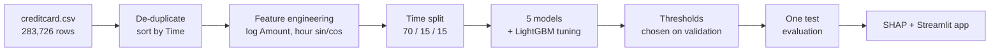
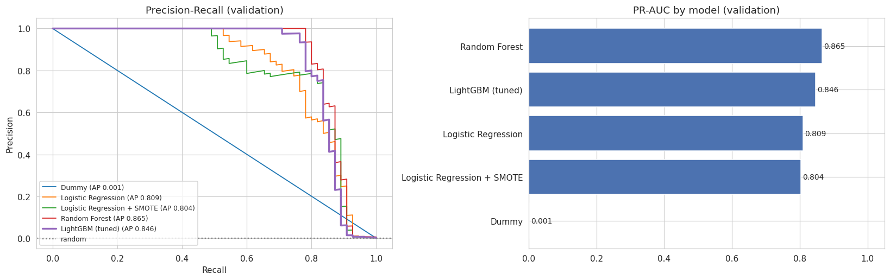
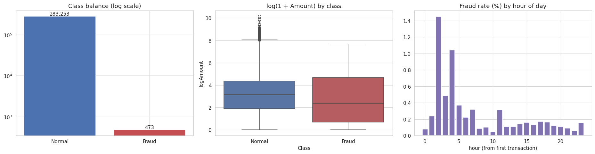

<div align="center">


### Catch fraud in a 0.17%-fraud world, explain every decision, and set the alert line using money instead of vanity metrics.

<br/>

<a href="https://credit-card-fraud-detection-027.streamlit.app/">
  
</a>
&nbsp;
<a href="https://credit-card-fraud-detection-027.streamlit.app/">
  
</a>

<br/><br/>


[Live demo](https://credit-card-fraud-detection-027.streamlit.app/) · [Results](#-results) · [The app](#-the-app) · [Quick start](#-quick-start) · [How it works](#-how-it-works) · [Gallery](#-gallery) · [Limitations](#-limitations)

</div>

---

## 🎯 The problem

Out of **283,726** real card transactions, only **473 (0.17%)** are fraud. A model that always says "normal" scores **99.83% accuracy** and catches **zero** fraud, so accuracy is useless here.

FraudSense is built around what actually matters: catching fraud, not annoying good customers, and knowing what each alert is worth.

<div align="center">

| 📊 PR-AUC (test) | 🎯 Fraud caught | ✅ Alert precision | 💶 Cost saved vs no model |
|:---:|:---:|:---:|:---:|
| **0.752** | **75%** | **76.5%** | **57.4%** |

</div>

## ✨ Highlights

| | |
|---|---|
| ⏱️ **Honest evaluation** | Time-ordered train / validation / test split. Thresholds are chosen on validation, and the test set is read once. |
| 📏 **Right metrics** | PR-AUC first, then precision, recall, F1, Precision@K and a business cost simulation. |
| 🤖 **5 models compared** | Dummy, Logistic Regression, LR + SMOTE, Random Forest and a tuned LightGBM. |
| 💶 **Money-based threshold** | Cost of missed fraud plus cost of analyst reviews, with a live what-if slider in the app. |
| 🔍 **Explainable** | Exact SHAP contributions from LightGBM, globally and for every single transaction. |
| 🎨 **Advanced Streamlit UI** | Glass UI with an animated backdrop, a risk-score ring, interactive Plotly charts, batch scoring and CSV download. |

## 🖥️ The app

<div align="center">

**[👉 Try it live: credit-card-fraud-detection-027.streamlit.app](https://credit-card-fraud-detection-027.streamlit.app/)**

</div>

| Page | What it does |
|---|---|
| 🏠 **Overview** | Headline metrics, pipeline, data split and an honest read of the results |
| 🔎 **Risk Checker** | Enter one transaction, get a risk-score ring, a verdict and a SHAP breakdown of the reasons |
| 📦 **Batch Scanner** | Upload a CSV, score every row, review the riskiest, explain any row, download results |
| 🧪 **Model Lab** | Model comparison, tuning trials, cost what-if slider, analyst review budget |
| 🧠 **Explainability** | Global SHAP importance and local explanations (caught fraud, missed fraud, false alarm) |
| 📊 **Data & EDA** | Class balance, feature distributions and the feature engineering table |

A sidebar switch lets you flag transactions by the **cost-optimal** threshold, the **F1-optimal** threshold, or your own.

> 💡 **Quick tour:** open the *Risk Checker*, press **Fraud-like profile**, and watch the ring turn red. Then check the SHAP chart to see which signals pushed the score up.

## 📈 Results

Test set = the newest 15% of transactions, read once.

| Model | PR-AUC | ROC-AUC |
|---|---:|---:|
| Random Forest | 0.7731 | 0.9493 |
| 🏆 **LightGBM (tuned), deployed** | **0.7516** | **0.9758** |
| Logistic Regression + SMOTE | 0.6999 | 0.9717 |
| Logistic Regression | 0.6921 | 0.9766 |
| Dummy | 0.0012 | 0.5000 |

LightGBM is deployed for speed and native SHAP even though Random Forest scored about 0.02 PR-AUC higher.

**Operating points for the deployed model**

| Policy | Threshold | Precision | Recall | F1 | Caught | Missed | False alarms | Total cost |
|---|---:|---:|---:|---:|---:|---:|---:|---:|
| F1-optimal | 0.83 | 90.2% | 71.2% | 0.796 | 37 | 15 | 4 | €2,657 |
| Cost-optimal | 0.64 | 76.5% | 75.0% | 0.757 | 39 | 13 | 12 | **€2,627** |

Without a model, every fraud gets through and the test window costs **€6,169**. The cost-optimal policy cuts that by **57.4%**.

> ⚠️ The test window contains only **52 frauds**, so every test metric has wide error bars. The €5 review cost is an assumption, not a bank figure.

## 🧠 How it works



- **Why a time split?** In real life a model trains on the past and scores the future. A random split leaks future patterns into training and inflates scores.
- **Why PR-AUC?** With 0.17% positives, PR-AUC reflects the quality of the alerts. ROC-AUC looks great even for weak models.
- **Why a cost threshold?** A missed fraud loses its full amount, while a false alarm costs an analyst review. The best threshold depends on that ratio.
- **Scores are for ranking.** The model uses `scale_pos_weight ≈ 23`, so a score of 0.9 is not a 90% probability.

<details>
<summary><b>Feature engineering</b></summary>

| Raw column | Becomes | Why |
|---|---|---|
| `V1` … `V28` | used as is | already PCA components from the data provider |
| `Amount` | `log_amount = log(1 + Amount)` | amounts are heavily right-skewed |
| `Time` (seconds) | `hour_sin`, `hour_cos` | hour of day as a circle, so 23:00 sits next to 00:00 |

</details>

<details>
<summary><b>Final LightGBM configuration</b></summary>

| Parameter | Value |
|---|---|
| `num_leaves` | 31 |
| `learning_rate` | 0.03 |
| `min_child_samples` | 100 |
| `feature_fraction` / `bagging_fraction` | 1.0 / 1.0 |
| `lambda_l2` | 5.0 |
| `scale_pos_weight` | ≈ 23.27 |
| Rounds | 168 (early stopping on validation PR-AUC) |

</details>

## 🚀 Quick start

```bash
git clone https://github.com/D0027/credit-card-fraud-detection.git
cd credit-card-fraud-detection
python -m venv .venv && source .venv/bin/activate      # Windows: .venv\Scripts\activate
pip install -r requirements.txt
streamlit run app.py
```

The trained model is already in `model/fraud_model.txt`, so the app works right away.

<details>
<summary><b>Retrain the model yourself</b></summary>

Download [`creditcard.csv`](https://www.kaggle.com/datasets/mlg-ulb/creditcardfraud) into `data/` and run:

```bash
python train.py --data data/creditcard.csv                    # reuses the notebook's best config (about 10 seconds)
python train.py --data data/creditcard.csv --tune 10          # or repeat the random search
python train.py --data data/creditcard.csv --review-cost 10   # re-tune thresholds for a different review cost
```

</details>

Want a quick batch demo? Click **Load demo file** in the Batch Scanner. It uses `data/sample_transactions.csv`, a **synthetic** file made by `scripts/make_demo.py`, so its scores only show how the app behaves.

## 📊 Gallery

<table>
<tr>
<td align="center"><br/><sub><b>Model comparison</b></sub></td>
<td align="center"><br/><sub><b>Threshold and cost selection</b></sub></td>
</tr>
<tr>
<td align="center"><br/><sub><b>Test evaluation</b></sub></td>
<td align="center"><br/><sub><b>SHAP: global importance</b></sub></td>
</tr>
<tr>
<td align="center"><br/><sub><b>SHAP: single transactions</b></sub></td>
<td align="center"><br/><sub><b>Data overview</b></sub></td>
</tr>
</table>

## 📁 Project structure

```
credit-card-fraud-detection/
├── app.py                    # Streamlit app (7 pages)
├── train.py                  # rebuild the model from creditcard.csv
├── requirements.txt
├── .streamlit/config.toml    # dark theme + upload limit
├── src/
│   ├── config.py             # paths, constants, notebook facts
│   ├── inference.py          # feature engineering, scoring, SHAP
│   ├── charts.py             # Plotly figures
│   └── ui.py                 # CSS theme and HTML components
├── model/                    # fraud_model.txt + model_meta.json
├── reports/                  # result tables exported from the notebook run
├── images/                   # plots exported from the notebook run
├── notebooks/credit-card-fraud.ipynb
├── scripts/make_demo.py      # builds the synthetic demo CSV
└── data/                     # sample_transactions.csv (+ creditcard.csv, not committed)
```

## 🛠️ Tech stack


## ⚠️ Limitations

- Only two days of European card transactions from September 2013, so there is no seasonality and fraud patterns have since drifted.
- `V1`–`V28` are anonymised PCA components, so their business meaning is unknown.
- 52 test frauds make precision and recall estimates noisy.
- This is a learning and portfolio project, not a production fraud system. A real one needs monitoring, drift checks, retraining and human review workflows.

## 🙏 Credits

Dataset: [Credit Card Fraud Detection](https://www.kaggle.com/datasets/mlg-ulb/creditcardfraud) by the Machine Learning Group, ULB, released under the Database Contents License (DbCL) v1.0. Reference: Dal Pozzolo, Caelen, Johnson and Bontempi, *Calibrating Probability with Undersampling for Unbalanced Classification*, IEEE CIDM 2015.

## 📄 License

Code released under the [MIT License](LICENSE). The dataset keeps its own license.

<div align="center">

**If this project helped you, drop a ⭐ on the repo.**

[▶ Open the live app](https://credit-card-fraud-detection-027.streamlit.app/)

</div>  
